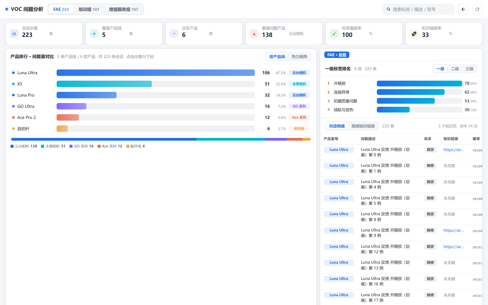
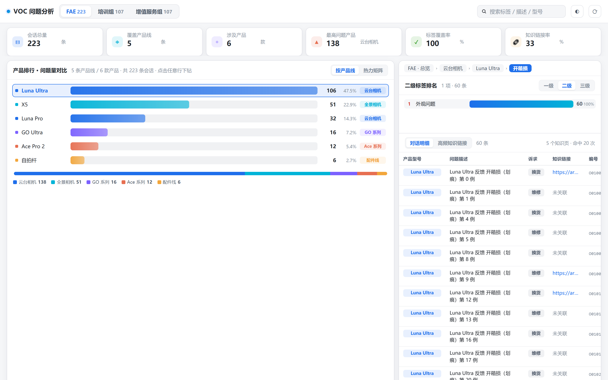
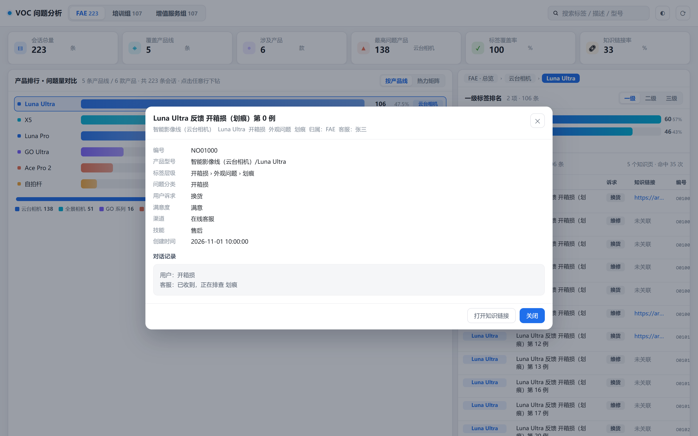

# VOC 问题分析看板 · 飞书多维表格应用插件

把「客户声音（VOC）」这类会话级数据表，变成一张**先看排行、再逐层下钻**的问题分析看板：
先直观看到每条产品线里哪个产品问题最多，点进去才是标签排名和对话明细。

- 纯前端静态项目（Vite 构建），构建产物为单个 `dist`，可直接部署到任意 HTTPS 静态托管
- 数据全部来自用户自己选择的多维表格，**不做任何外部上报**
- 中 / 英 / 日三语，兼容深色模式与容器缩放



## 功能

| 区域 | 说明 |
| --- | --- |
| 顶部 KPI | 会话总量、覆盖产品线、涉及产品、最高问题产品、标签覆盖率、知识链接率 |
| 主视图：产品排行 | 按产品问题量降序的横向柱状排行，按产品线配色，底部附产品线占比小计条与图例；点击任意行下钻 |
| 主视图：热力矩阵 | 产品线 × 一级标签的交叉热力表，色深表示问题量，点击单元格下钻 |
| 右侧：标签排名 | 一级 / 二级 / 三级标签按层级收敛，点击继续下钻 |
| 右侧：对话明细 | 产品型号、问题描述、用户诉求、知识链接、编号；点击行看完整对话 |
| 右侧：高频知识链接 | 当前范围内被引用最多的知识页排行，可直接跳转 |
| 全局 | 团队归属（FAE / 培训组 / 增值服务组）切换、关键词搜索、深浅色切换、手动重载 |




## 快速开始

```bash
npm install
npm run dev      # 本地开发，浏览器打开 http://localhost:5173
npm run build    # 产出 dist/
```

部署条件（官方要求）：Node 16.19.0 环境下 `npm install` 与 `npm run build` 均可成功；
`vite.config.js` 中必须保留 `base: './'`，否则部署失败。

`package.json` 里设置了 `"output": "dist"`，上传时可跳过打包，直接使用 `dist` 目录。

## 目录结构

```
index.html              宿主页面（挂载点 #root）
vite.config.js          构建配置（base:'./' 为硬性要求）
src/
  main.js               入口：装配 i18n、主题、取数、渲染、宿主事件
  styles/app.css        全部样式；深浅色由 html[data-theme] 切换
  i18n/                 zh.json / en.json / jp.json + 运行时 t()
  data/
    sdk.js              飞书 JS SDK 动态加载（版本固定）
    bridge.js           宿主桥接：状态判定、多维表格选择、取数、配置读写
    source.js           字段语义匹配、单元格归一化、产品型号拆解
  ui/
    app.html            页面骨架（含 data-i18n 标记）
    render.js           各视图渲染与交互
    theme.js            产品线配色、数值格式化
    util.js             事件委托、尺寸监听、空态/加载态
    i18n-dom.js         静态节点文案填充
assets/                 图标、介绍图、使用录屏
```

## 与宿主的三条硬约束

应用插件在 iframe 里被宿主驱动，状态不同走的接口也不同。**用错接口会让宿主在点「确定」后判定保存失败**：

| 状态 | URL 参数 | 取数接口 | 是否可写配置 |
| --- | --- | --- | --- |
| Create（首次添加） | `isCreate=1` | `getPreviewData` | 可（`saveConfig`） |
| Config（配置中） | `isConfig=1` | `getPreviewData` | 可（`saveConfig`） |
| View（展示） | 默认 | 明细接口 `getRecordsByPage` | 不可 |
| FullScreen（仪表盘全屏） | `isFullScreen=1` | 同 View | 不可 |

实现要点：

1. **状态从 URL 读**。`location.search` 与 `location.hash` 都会解析，避免宿主把参数放在 hash 段时读不到；同时用 `hashchange` / `popstate` + 1.5s 轮询兜底，保证「配置 → 展示」切换后不会停留在预览数据。
2. **数据源不写死**。不硬编码 `baseToken` / `tableId`，而是 `workspace.getBaseList()` → `getBitable()` → 遍历表 → 按语义匹配字段，挑出最匹配的那张表；每个插件实例换表也能用。
3. **渲染完成必须 `setRendered()`**，否则宿主一直停在加载态、自动化截图也会失败。
4. **配置写回 `dataConditions`**，保证「创建副本」时能正确取到字段。
5. **监听 `onDataChange` / `onConfigChange`**，表结构或筛选变化后实时重绘。

## 部署

把 `dist/` 目录部署到任意 HTTPS 静态托管即可（对象存储 + CDN、内部静态服务器均可）。
插件不需要任何后端服务，也不发起除飞书 SDK 之外的网络请求。

## 数据安全

- 仅通过 `@lark-base-open/js-sdk` 读取用户在当前应用里已授权的多维表格数据
- 不向任何第三方域名发送表格数据，无埋点、无遥测
- 无 `eval` / `new Function`，无动态拼接的远程脚本
- 唯一外部依赖是飞书官方 JS SDK（`cdn.jsdelivr.net`，版本锁定在 `src/data/sdk.js`）

## 国际化

`src/i18n/` 下 `zh.json` / `en.json` / `jp.json` 三份文案的 key 完全对齐，运行时按 `bridge.getLocale()` 自动切换，取不到时回落浏览器语言。

## 浏览器兼容

Chrome / Edge / Safari 最新两个大版本（宿主内嵌 Chromium 内核）。

## 许可

私有项目，未开源分发。
